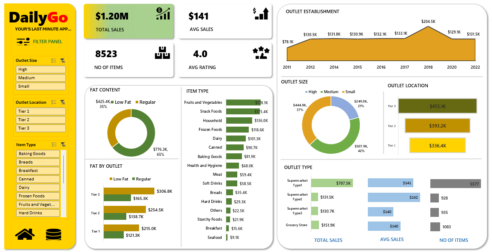
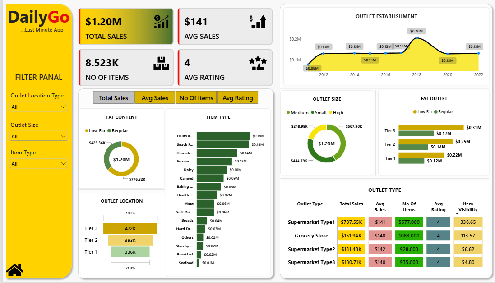

# 🛒 DailyGo Analysis

## 📋 BUSINESS REQUIREMENTS DOCUMENT (BRD)

### 🎯 Business Requirement

To conduct a comprehensive analysis of DailyGo's sales performance, customer satisfaction, and inventory distribution to identify key insights and opportunities for business optimization using various KPIs and visualizations.

The project involves **Microsoft Excel, SQL, and Power BI** for data cleaning, data analysis, data transformation, and interactive dashboard development.

EXCEL DASHBOARD

POWER BI DASHBOARD

## 📊 1. KPI's Requirements

1. **Total Sales:** The overall revenue generated from all items sold.

2. **Average Sales:** The average revenue generated per sale.

3. **Number of Items:** The total count of different items sold.

4. **Average Rating:** The average customer rating for items sold.

---

## 📈 2. Granular Requirements

### 1. Total Sales by Fat Content

- **Objective:** Analyze the impact of fat content on total sales.
- **Additional KPI Metrics:** Assess how other KPIs (Average Sales, Number of Items, Average Rating) vary with fat content.

### 2. Total Sales by Item Type

- **Objective:** Identify the performance of different item types in terms of total sales.
- **Additional KPI Metrics:** Assess how other KPIs (Average Sales, Number of Items, Average Rating) vary across different item types.

### 3. Fat Content by Outlet for Total Sales

- **Objective:** Compare total sales across different outlets segmented by fat content.
- **Additional KPI Metrics:** Assess how other KPIs (Average Sales, Number of Items, Average Rating) vary with fat content across outlets.

### 4. Total Sales by Outlet Establishment

- **Objective:** Evaluate how the age and establishment year of an outlet influence total sales performance.

---

## 📊 3. Chart's Requirements

### 5. Percentage of Sales by Outlet Size

- **Objective:** Analyze the relationship between outlet size and total sales.
- **Visualization:** Donut Chart.

### 6. Sales by Outlet Location

- **Objective:** Assess the geographical distribution of sales across different outlet locations.
- **Visualization:** Funnel Chart.

### 7. All Metrics by Outlet Type

- **Objective:** Provide a comprehensive view of all key metrics (Total Sales, Average Sales, Number of Items, Average Rating) broken down by different outlet types.
- **Visualization:** Matrix Table.

---

## 🛠️ 4. Tools & Technologies Used

| Tools | Purpose |
|---|---|
| Microsoft Excel | Data cleaning, data formatting and preliminary analysis. |
| SQL | Data extraction, data cleaning, transformation and analytical queries. |
| Microsoft Power BI | Data modelling, DAX calculations, KPI development and interactive dashboard creation. |

---

## 🗂️ 5. Data Requirements

The project uses the following data fields:

- Item Identifier
- Item Fat Content
- Item Type
- Item Weight
- Item Visibility
- Item Outlet Sales
- Outlet Identifier
- Outlet Establishment Year
- Outlet Size
- Outlet Location Type
- Outlet Type
- Item Rating (where available in the source dataset)

---

## 🎯 6. Expected Outcome

To develop an interactive business intelligence dashboard that provides meaningful insights into sales performance, product categories, outlet performance, and customer satisfaction.

The analysis aims to:

- Identify high-performing product categories.
- Understand sales distribution by fat content.
- Compare sales performance across different outlets.
- Analyze the relationship between outlet size and sales.
- Evaluate sales performance across outlet locations.
- Understand customer ratings and satisfaction.
- Support business decisions through data-driven insights.

---

## 📦 7. Project Deliverables

1. **Excel:** Data cleaning, formatting and preliminary analysis.
2. **SQL:** Data extraction, transformation and analytical queries.
3. **Power BI:** Interactive dashboard with KPIs, charts and visualizations.
4. **BRD:** Business requirements and analytical objectives.

---

## 💻 Project Information

| Category | Details |
|---|---|
| Project Name | DailyGo Analysis |
| Domain | Retail & Sales Analytics |
| Tools | Excel, SQL, Power BI |
| Project Type | End-to-End Data Analytics |
| Output | Interactive Business Intelligence Dashboard |

---

**Developed using Excel | SQL | Power BI**
