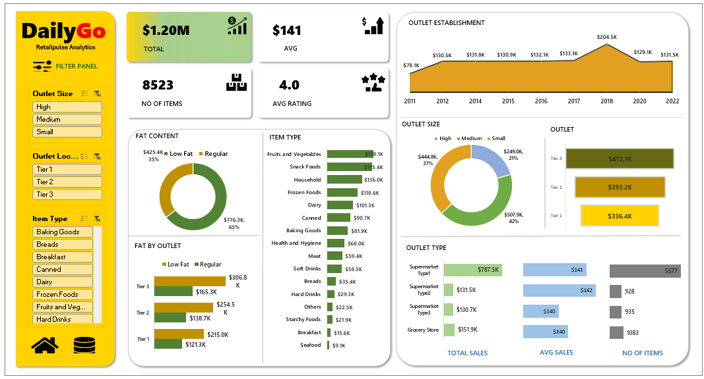

# 🚦 Road Accident Analysis Dashboard

EXCEL DASHBOARD

POWER BI DASHBOARD

## 📋 BUSINESS REQUIREMENTS DOCUMENT (BRD)

### 🎯 1. Business Requirement

To conduct a comprehensive analysis of road accidents and casualties to identify key insights, trends, and factors contributing to road accidents. The objective is to analyze casualty severity, vehicle types, road conditions, weather conditions, lighting conditions, and geographical distribution to understand accident patterns and support data-driven road safety analysis.

The project uses **Microsoft Excel, SQL, and Power BI** for data cleaning, data analysis, and interactive dashboard development.

---

## 📊 2. KPI's Requirements

1. **Total CY Casualties:** The total number of casualties recorded in the Current Year.

2. **Total CY Accidents:** The total number of road accidents recorded in the Current Year.

3. **CY Fatal Casualties:** The total number of casualties resulting in fatalities during the Current Year.

4. **CY Serious Casualties:** The total number of casualties classified as serious during the Current Year.

5. **CY Slight Casualties:** The total number of casualties classified as slight during the Current Year.

6. **CY vs PY Casualties:** Compare Current Year casualties with Previous Year casualties to identify the percentage increase or decrease.

## 📈 3. Granular Requirements

### 1. CY Casualties vs PY Casualties – Monthly Trend

- **Objective:** Compare Current Year and Previous Year casualties month by month to identify trends and variations.
- **Additional KPI Metrics:** Monthly casualty count and year-over-year percentage change.

### 2. Casualties by Vehicle Type

- **Objective:** Identify which vehicle categories contribute most to total casualties.
- **Categories:** Car, Bike, Bus, Van, Agricultural and Other.

### 3. Casualties by Road Type

- **Objective:** Identify the road types associated with the highest number of casualties.
- **Categories:** Single Carriageway, Dual Carriageway, Roundabout, One-way Street and Slip Road.

### 4. Casualties by Urban/Rural Area

- **Objective:** Compare casualty distribution between Urban and Rural areas to identify differences in accident patterns.

### 5. Casualties by Road Surface

- **Objective:** Analyze casualties under different road surface conditions.
- **Categories:** Dry, Wet, Snow/Ice and other available conditions.

### 6. Casualties by Light Condition

- **Objective:** Analyze casualties occurring during Day and Night/Dark conditions to understand the impact of lighting conditions.

### 7. Casualties by Weather Condition

- **Objective:** Analyze how different weather conditions influence road accident and casualty levels.

### 8. Casualties by Location

- **Objective:** Identify geographical areas with higher casualty concentrations and understand accident distribution across different locations.

---

## 📊 4. Chart's Requirements

1. **Monthly Casualty Trend:** Line Chart – Compare CY vs PY casualties by month.

2. **Casualties by Vehicle Type:** Bar Chart – Display casualties across different vehicle categories.

3. **Casualties by Road Type:** Horizontal Bar Chart – Compare casualties across different road types.

4. **Urban vs Rural Casualties:** Donut Chart – Display casualty distribution between Urban and Rural areas.

5. **Casualties by Light Condition:** Donut Chart – Compare Day and Night casualties.

6. **Casualties by Road Surface:** Stacked Bar Chart – Analyze casualties across different road surface conditions.

7. **Casualties by Location:** Map Visual – Display geographical distribution of casualties.

8. **KPI Cards:** Display Total Casualties, Total Accidents, Fatal Casualties, Serious Casualties and Slight Casualties.

---

## 🛠️ 5. Tools & Technologies Used

| Tools | Purpose |
|---|---|
| Microsoft Excel | Data cleaning, formatting and preliminary data analysis. |
| SQL | Data extraction, filtering, querying and analytical calculations. |
| Microsoft Power BI | Data modelling, DAX calculations, KPI development and interactive dashboard creation. |

---

## 🗂️ 6. Data Requirements

The project uses the following data fields, depending on the source dataset:

- Accident ID
- Accident Date
- Year
- Month
- Casualty Severity
- Vehicle Type
- Road Type
- Road Surface
- Light Condition
- Weather Condition
- Urban/Rural Area
- Location
- Latitude
- Longitude

---

## 🔑 7. Primary Key & Foreign Key Requirements

### Primary Key

1. **Accident_Index:** Unique identifier used to identify individual accident records in the accident table.

2. **Casualty Reference:** Identifies individual casualty records. If multiple casualties belong to one accident, a combination of Accident_Index and Casualty_Reference may be required as the composite primary key.

### Foreign Key

1. **Accident_Index:** Connects casualty records with their corresponding accident records.

2. **Date Key:** Connects accident records with the calendar/date dimension for time-based analysis.

3. **Vehicle Reference:** Helps establish relationships between accident and vehicle records when separate tables are used.

**Note:** Primary and foreign keys must be validated against the actual source dataset. The above key structure assumes a relational accident and casualty data model.

---

## 🎯 8. Expected Outcome

To develop an interactive Power BI dashboard that provides a comprehensive overview of road accidents and casualties.

The dashboard helps users:

- Identify accident and casualty trends.
- Compare Current Year and Previous Year performance.
- Understand casualty severity.
- Identify high-risk vehicle categories.
- Analyze road type and road surface conditions.
- Understand the impact of weather and lighting conditions.
- Compare Urban and Rural casualties.
- Identify accident-prone geographical locations.

---

## 📦 9. Project Deliverables

1. **Excel:** Data cleaning and preliminary analysis.
2. **SQL:** Data extraction, transformation and analytical queries.
3. **Power BI:** Interactive dashboard with KPIs, charts and filters.
4. **BRD:** Business requirements and analytical objectives.

---

## 💻 Project Information

- **Project Name:** Road Accident Analysis
- **Domain:** Road Safety & Data Analytics
- **Tools:** Excel | SQL | Power BI
- **Project Type:** End-to-End Data Analytics Project
- **Dashboard:** Interactive Power BI Dashboard

---
